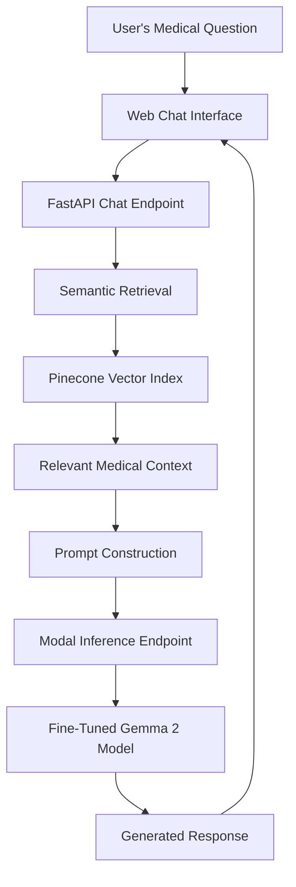

# AI Clinician Chatbot

**An in-progress medical question-answering project exploring fine-tuned language models, retrieval-augmented generation, and safer patient-facing responses.**

AI Clinician Chatbot is a personal AI project designed to generate conversational responses to medical and symptom-related questions. The project combines domain-specific dataset preparation, parameter-efficient model fine-tuning, semantic retrieval, and prompt engineering to explore how medical information can be delivered in a clear, relevant, and safety-conscious manner.

**Project status:** IN PROGRESS

[View the source code on GitHub](https://github.com/Rohanpatel512/AI-Clinician-Chatbot)

## Overview

General-purpose language models can produce fluent answers to medical questions, but fluency does not guarantee factual accuracy, appropriate uncertainty, or safe guidance.

This project explores a multi-stage approach to medical question answering:

- **Medical data preparation:** Curating and processing question-answer datasets for medical and symptom-related queries.
- **Response quality improvement:** Filtering data and rewriting selected examples to encourage clear, patient-friendly, and appropriately cautious responses.
- **Model fine-tuning:** Experimenting with instruction-tuned language models and Low-Rank Adaptation (LoRA).
- **Retrieval-augmented generation (RAG):** Retrieving relevant medical information and incorporating it into the model's prompt.
- **Application development:** Connecting the retrieval and inference pipeline to a FastAPI backend and a browser-based chat interface.

The goal is to investigate how these components can work together to produce more useful and contextually relevant medical responses—not to replace professional medical judgment.

## System Architecture



The application separates retrieval, prompt construction, and model inference into distinct components. This allows the data pipeline, retrieval behavior, and model-serving implementation to be developed and evaluated independently.

## Machine Learning Pipeline

### 1. Medical Dataset Preparation

The training-data workflow combines medical question-answer resources, including MedQuAD and symptom-oriented question-answer data.

Data preparation and experimentation have included:

- Processing and structuring medical question-answer examples.
- Deduplicating examples and preparing data for training.
- Using natural language inference (NLI) filtering to screen candidate examples for relevance and consistency.
- Rewriting selected examples to improve readability and encourage a calm, patient-friendly communication style.
- Preparing datasets for model training and evaluation.

The rewriting workflow uses an instruction-following language model to improve how questions and answers are expressed while aiming to preserve their medical meaning.

The prompts emphasize uncertainty where appropriate, avoiding unsupported diagnoses and medication-dosing recommendations, and not introducing unsupported medical facts.

### 2. Model Fine-Tuning

The project has explored FLAN-T5 during earlier experiments and has since moved toward a Gemma-based instruction-tuning approach.

The current inference implementation uses **Gemma 2 9B IT (`google/gemma-2-9b-it`)**, with a fine-tuned adapter loaded through the PEFT library.

The model-development workflow includes:

- Instruction-oriented medical question-answer training data.
- LoRA-based parameter-efficient fine-tuning.
- Training-checkpoint inspection and iterative experimentation.
- Evaluation of generated answers for relevance, medical appropriateness, and response quality.
- Investigation of training-data quality and model-output issues.

Model selection and training are still evolving. Training loss alone is not treated as evidence that a model's medical responses are accurate or safe.

### 3. Retrieval-Augmented Generation (RAG)

The application incorporates retrieval to provide relevant medical context alongside the user's question and recent conversation history.

The retrieval pipeline uses:

- **Pinecone** for vector search and storage.
- Pinecone's integrated `llama-text-embed-v2` embedding model.
- A medical information collection prepared from resources including MedlinePlus and Wikipedia.
- Prompt construction that combines the current question, retrieved context, and conversation history.

At a high level, the pipeline retrieves a relevant text passage, incorporates it into an instruction-guided prompt, and sends the prompt to the fine-tuned model for response generation.

The purpose of retrieval is to give the model additional relevant context. Retrieval by itself does not guarantee that a generated answer is supported by the retrieved material; this remains an important area for further evaluation.

### 4. Inference and Model Serving

The model-serving implementation uses Modal to run inference separately from the main application backend.

The current inference path includes:

- Loading the Gemma 2 9B instruction-tuned base model.
- Four-bit NF4 quantization to reduce model memory requirements.
- Loading the fine-tuned PEFT adapter.
- Generating responses through the Transformers generation API.
- Exposing inference through a Modal endpoint consumed by the backend.

This separation keeps the web application and model inference components independent.

## Application Stack

| Component | Technology |
|---|---|
| Language | Python |
| Model development | PyTorch, Hugging Face Transformers |
| Base model | Gemma 2 9B IT |
| Fine-tuning | PEFT, LoRA |
| Quantization | BitsAndBytes, four-bit NF4 |
| Model serving | Modal |
| Backend API | FastAPI |
| Retrieval and vector search | Pinecone |
| Embeddings | `llama-text-embed-v2` |
| Data processing and filtering | Python, NLP/NLI techniques |
| Frontend | HTML, CSS, JavaScript |
| Configuration | Environment variables and `python-dotenv` |

## Repository Structure

```text
AI-Clinician-Chatbot/
├── app/
│   ├── api/
│   │   └── chat.py
│   ├── core/
│   │   └── config.py
│   ├── services/
│   │   └── rag_pipeline.py
│   └── main.py
├── frontend/
│   ├── js/
│   ├── style/
│   └── index.html
├── notebooks/
├── rag/
│   ├── augmentation.py
│   └── vector_store.py
├── utils/
├── modal_app.py
└── README.md
```

The notebooks contain the model-development and experimentation work, while the application code separates the chat API, retrieval pipeline, vector-store operations, prompt construction, and inference service.

## Safety and Reliability Considerations

Medical question answering requires particular care because an incorrect or overconfident response can have serious consequences.

Safety-oriented design considerations explored in this project include:

- Encouraging clear, patient-friendly language.
- Communicating uncertainty rather than presenting unsupported conclusions as facts.
- Avoiding unsupported diagnoses and medication-dosing advice.
- Providing instructions to seek emergency assistance when a situation may be urgent.
- Improving the relevance and consistency of the training data.
- Reviewing generated responses rather than relying solely on training metrics.

These measures are design goals and safeguards under development; they do not establish that the system is clinically safe or reliable.

## Current Development Priorities

The project is still under active development. The main areas of continued work are:

- **Training and model evaluation:** Assessing model checkpoints on medical questions not used for training.
- **Response quality:** Improving relevance, completeness, readability, and appropriate handling of uncertainty.
- **Retrieval quality:** Evaluating whether retrieved passages contain useful evidence for the question being asked.
- **Safety testing:** Examining potentially dangerous questions, unsupported claims, and responses that require urgent medical attention.
- **End-to-end integration:** Refining the interaction between the fine-tuned model, RAG pipeline, FastAPI backend, and frontend.
- **Deployment and reliability:** Improving error handling and preparing a stable end-to-end demonstration.

## Limitations and Intended Use

This is an experimental personal project for learning and research in language-model fine-tuning and medical question answering.

- It has not been clinically validated.
- Its outputs may be inaccurate, incomplete, or misleading.
- Retrieved information may be irrelevant or insufficient to support a response.
- Fine-tuning and retrieval do not eliminate hallucinations.
- The system is not intended to diagnose, treat, or replace consultation with a qualified healthcare professional.

**Do not rely on this project for medical decisions or emergencies.** Anyone experiencing a potential medical emergency should contact local emergency services.

## Author

**Rohan Patel**

Computer Science graduate interested in machine learning, NLP, and building practical AI applications.

- [GitHub](https://github.com/Rohanpatel512)
- [AI Clinician Chatbot Repository](https://github.com/Rohanpatel512/AI-Clinician-Chatbot)

---

*This project is a work in progress. Features, model configurations, evaluation methods, and deployment details may change as development continues.*